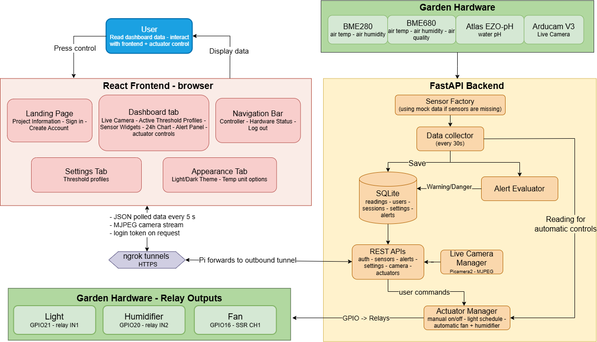
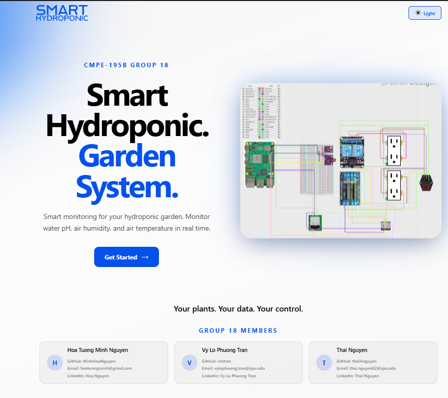
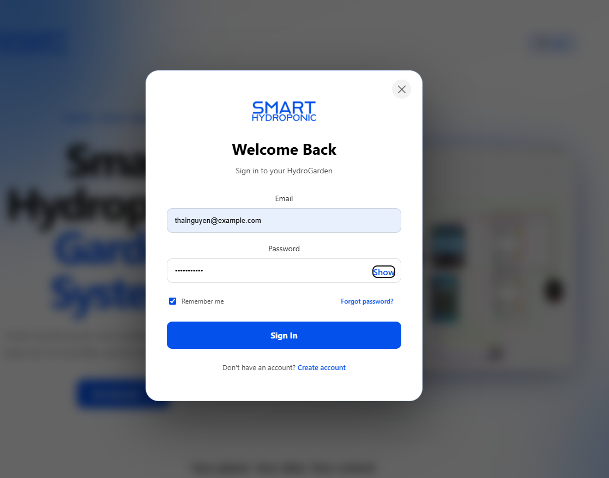
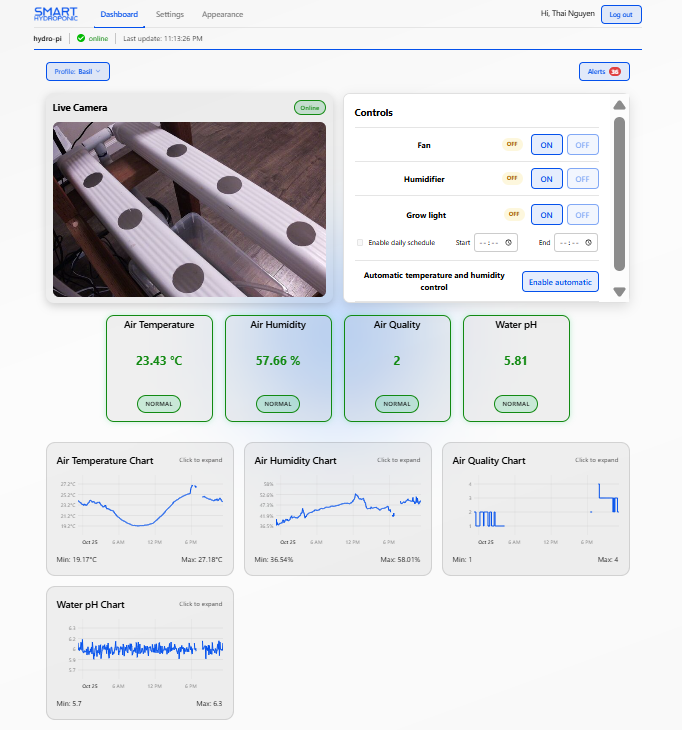
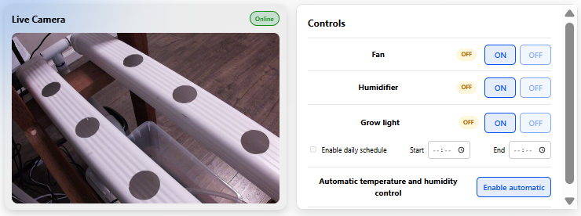
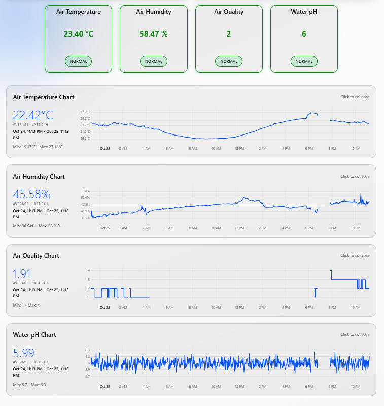

# SMART HYDROPONIC GARDEN SYSTEM

## Team
- Hoa Tuong Minh Nguyen ([@MinhHoaNguyen](https://github.com/MinhHoaNguyen))
- Vy Lo Phuong Tran ([@vlotran](https://github.com/vlotran))
- Thai Nguyen ([@thaiHnguyen](https://github.com/thaiHnguyen))

## Project Description
Small hydroponic growers have to check pH, temperature and humidity by hand, and problems often go unnoticed until plants are damaged. Our system uses a Raspberry Pi 5 with a live camera and sensors to read garden data every 30 seconds, stores the readings, and shows them on a browser dashboard. It evaluates readings against each signed-in user's active profile and shows alerts. Users can manually control the fan, humidifier and grow light, schedule the grow light, or enable profile-based on/off temperature and humidity control.

## Prototype Scope
**Works end to end now:**
- Sensors -> Raspberry Pi -> FastAPI -> SQLite -> React dashboard

- Four metrics on the dashboard air temperature, air humidity, air quality score and water pH (each with a sensor data widget and a 24-hour chart)

- Live camera view of the plants on the dashboard (Arducam V3 camera)

- User accounts: create account, sign in with 6-hour session, log out

- Per-user threshold profiles: every account starts with 10 example profiles (Lettuce, Tomato, Basil) and user can add, edit, delete and activate them on their own

- Alerts: each reading is checked against each user's active profile; Warning/Danger states on the cards, a popup for Danger, and an alert history panel with an unread badge and "Mark all as read"

- Appearance settings: light/dark theme, °C to °F convertion

- Mock sensor mode: the whole system runs on a laptop without hardware

- Shared actuator controls: manual fan, humidifier and grow-light controls; daily grow-light scheduling; optional automatic fan/humidifier control using the signed-in user's active profile and hysteresis

- CI on every push (GitHub Actions): tests, lint and build on every push; every green commit on main is deployed to the Pi automatically, with a database backup and automatic rollback if the backend doesn't come back healthy

**Incomplete:**
- Password reset ("Forgot password?") is not implemented
- The frontend runs locally and reaches the Pi through ngrok; it is not hosted at a public URL yet.
- The pH sensor still uses simulated data on the Pi; BME280 and BME680 readings are live.
- Automatic actuator control and physical relay outputs require Pi hardware and are disabled by default; mock mode cannot verify physical switching.

## System Architecture

- **Sensors:** 
    + BME280: Air temperature (C), air humidity (%)
    + BME680: Air temperature (C), air humidity (%), air quality
    + Atlas Scientific EZO-pH: Water pH (0–14)
- **Live Camera:** Arducam V3 using Picamera2 to stream MJPEG to the dashboard. The browser gets a short-lived stream token, so the login token never appears in a URL. Without a camera, the widget shows "unavailable" and everything else keeps working.
- **Data collector:** a background task in the backend reads every sensor, stores the reading, and evaluates it against every user's active profile. If a sensor's hardware is missing, that sensor falls back to mock data on its own.
- **API:** FastAPI. Sensor data is public; profiles and alerts need a login token (`Authorization: Bearer <token>`).
- **Networking**: the ngrok agent runs on the Pi and opens an outbound tunnel to ngrok, which gives the backend a public HTTPS URL and forwards each request to localhost:8000. The Pi needs no port forwarding or public IP, so it works behind the school or home network.
- **Deployment:** a self-hosted GitHub runner on the Pi pulls each green commit on `main`, backs up the database, restarts the `hydroponic` systemd service and rolls back if the health check fails ([docs/CI_CD.md](docs/CI_CD.md)).
- **Database:** SQLite (`data/hydroponic.db`) with tables for readings, users, sessions, profiles and alerts. Older databases are upgraded automatically on startup.
- **Frontend:** React + Vite. It calls the backend through `VITE_API_BASE_URL: localhost:8000` during development, or the Pi's ngrok URL.
- **Actuators:** authenticated dashboard controls switch the fan (GPIO16 / SSR CH1), humidifier (GPIO20 / mechanical IN2) and grow light (GPIO21 / mechanical IN1). GPIO12 / SSR CH2 is unused. Users can set a daily grow-light schedule. Optional automatic control switches the fan and humidifier using profile-range hysteresis; it requires real sensors and `ACTUATOR_HARDWARE_ENABLED=True`, which defaults to false. No water-pump control is implemented.
- **Control behavior:** manual controls are user-operated. When automatic temperature/humidity control is explicitly enabled, sensor readings can switch the fan and humidifier on or off; it is not a variable-speed or PID controller.
- **Deployment Pipeline**:


## Prerequisites
- Python: Version 3.11+
- Node.js: 20.19+ or 22.12+
- Git: any

**Hardware (for live sensors, camera and physical actuator control):**
    + Raspberry Pi 5 with I2C enabled, BME280, BME680, Atlas Scientific EZO-pH (I2C mode), and a compatible Raspberry Pi camera.
    + Relay outputs: fan on GPIO16 / SSR CH1, humidifier on GPIO20 / mechanical IN2, and grow light on GPIO21 / mechanical IN1. GPIO12 / SSR CH2 is unused; water-pump control is not implemented.
    + Physical outputs default to disabled. Verify wiring, relay compatibility and connected loads before setting `ACTUATOR_HARDWARE_ENABLED=True`. Without hardware, use mock mode to test software behavior.

**Accounts:** no external account is needed to run locally, but create an application account to use the signed-in dashboard. Public access to the team's Pi uses the team's ngrok setup.

## Installation
1. Clone the repository:
   ```bash
   git clone https://github.com/vlotran/CMPE195A-Group-18.git
   cd CMPE195A-Group-18
   ```
2. Install backend dependencies (from the repo root):
   ```bash
   pip install -r requirements.txt
   ```
3. Create the backend config. On a machine without sensors, set `USE_MOCK_SENSORS=True` in it:
   ```bash
   cp .env.example .env
   ```
4. Install frontend dependencies and create its config:
   ```bash
   cd frontend
   npm install
   cp .env.example .env
   cd ..
   ```
5. **Raspberry Pi only:** install the hardware libraries into the same Python that runs the backend, and set `USE_MOCK_SENSORS=False` in `.env`:
   ```bash
   pip install adafruit-blinka adafruit-circuitpython-bme280 adafruit-circuitpython-bme680 smbus2
   sudo apt install -y python3-picamera2 

### Environment variables
`.env` files are gitignored. The `.env.example` files list every variable; no secrets are needed.

**Backend** (`.env` in the repo root):
-
- `APP_NAME`: API title
- `CONTROLLER_NAME`: Device name shown in the navbar (defaults to the hostname)
- `DEBUG`: Auto-reload and debug output
- `LOG_LEVEL`: Log detail (`INFO`, `DEBUG`, ...) 
- `API_HOST`, `API_PORT`: Address the API listens on
- `DATABASE_PATH`: SQLite file, relative to the repo root 
- `USE_MOCK_SENSORS`: `True` = simulated sensors, `False` = real I2C sensors 
- `SENSOR_READ_INTERVAL`: Seconds between sensor reads 
- `ALLOWED_ORIGINS`: Frontend URLs allowed to call the API (comma-separated, or `*`) 
- `ACTUATOR_HARDWARE_ENABLED`: Enables physical relay outputs; defaults to `False` and should only be enabled on the Pi after checking wiring and loads
- `ACTUATOR_PROFILE_USER_ID`: Optional user ID for actuator observation logging; automatic control instead uses the signed-in user who enables it

**Frontend** (`frontend/.env`):
- `VITE_API_BASE_URL`: Backend URL: the local backend (for mock sensor data) or the Pi's ngrok URL (for live sensor data)

## Running the Prototype
Start the backend **from the repo root** (the database path is relative to it):
```bash
python -m backend.src.main
```
In a second terminal, start the frontend:
```bash
cd frontend
npm run dev
```
Open `http://localhost:5173`, click **Get Started -> Create account**, then sign in.

- **Without hardware:** `USE_MOCK_SENSORS=True` and `VITE_API_BASE_URL=http://localhost:8000`. The camera widget shows "unavailable"; physical actuator controls remain disabled.
- **With the Pi:** the backend runs on the Pi as the `hydroponic` systemd service (`sudo systemctl status hydroponic`). Point `VITE_API_BASE_URL` at the Pi's ngrok URL and create an account there (accounts are stored per database).
- **API docs:** `http://localhost:8000/docs`

After changing `frontend/.env`, restart `npm run dev`.

## Testing

```bash
python -m pytest tests -v                       # backend, from the repo root
cd frontend && npm run lint && npm run build    # frontend checks
```
75 backend tests, no hardware needed:

- `tests/test_alert_evaluator.py`:  24 tests - Normal / Warning / Danger bands for every metric, hysteresis, recovery 
- `tests/test_auth.py`: 15 tests -  Register, login, wrong password, logout, expired sessions; users can't see or change each other's profiles or alerts; per-user alerts 
- `tests/test_sensor_factory.py`: 7 tests - Real/mock selection per sensor data and fallback to mock when hardware is missing 
- `tests/test_camera_manager.py`: 3 tests - Stream output waits for a fresh frame; concurrent starts open the camera only once 
- `tests/test_actuator_controller.py`, `tests/test_actuator_observation.py`, and `tests/test_actuators.py`- Total 26 tests:
   + profile-band hysteresis
   + sensor observation, API behavior
   + relay mapping, manual output and grow-light schedule tests (mock GPIO; no physical relays required)

GitHub Actions runs all of these on every push and pull request (`.github/workflows/ci.yml`). 
A green run on `main` triggers the deploy to the Pi (`.github/workflows/deploy.yml`). Details: [docs/CI_CD.md](docs/CI_CD.md).

## Demo
[CMPE 195B Implementation 2: Prototype - YouTube](https://www.youtube.com/watch?v=x4Ds_oYojNE)

- Frontend:
   + Landing Page:

   

   
   
   + Dashboard:
   
   

   

   
   
   + Settings:
   

   + Appearance:
   

## Technical Stack
- **Languages:** Python, JavaScript (JSX), SQL
- **Frontend:** React 19, Vite 7, Tailwind CSS 4 + custom CSS, custom SVG charts
- **Backend:** FastAPI, Uvicorn, Pydantic v2, pydantic-settings, asyncio, Loguru
- **Database:** SQLite via aiosqlite
- **Auth:** scrypt password hashing and session tokens (Python standard library)
- **Hardware:** Raspberry Pi 5; BME280, BME680, Atlas Scientific EZO-pH; Arducam V3 camera
- **Hardware libraries:** Adafruit CircuitPython (BME280/BME680), smbus2 (EZO-pH), Picamera2 (camera)
- **Networking:** ngrok
- **Testing / CI/CD:** pytest, ESLint, GitHub Actions, self-hosted runner + systemd on the Pi

## What's Next
- Deploy and host the frontend at a public URL
- Connect and calibrate the pH sensor so water pH readings are live on the Pi
- Add peristaltic dosing pumps for pH adjustment and nutrient dosing, plus water EC and water-level sensors
- Consider push notifications for Warning and Danger alerts
- Add email integration and password reset
- Refine the dashboard typography and resolve the remaining font asset warnings
