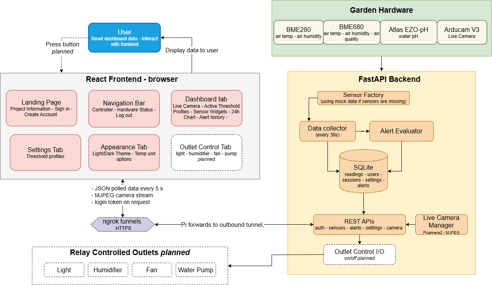
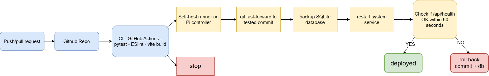

# SMART HYDROPONIC GARDEN SYSTEM (the one we will submit)

## Team
- Hoa Tuong Minh Nguyen (GitHub: @MinhHoaNguyen)
- Vy Lo Phuong Tran (GitHub: @vlotran)
- Thai Nguyen (GitHub: @thaiHnguyen)

## Project Description
Small hydroponic growers have to check pH, temperature and humidity by hand, and problems often go unnoticed until plants are damaged. Our system uses a Raspberry Pi 5 with live camera and I2C sensors to read the garden data every 30 seconds, stores the readings, and shows them on a browser dashboard. It is an open-loop system: it senses, stores, displays and alerts so that the user can decide what to do. 

## Prototype Scope
**Works end to end now:**
- Sensors -> Raspberry Pi -> FastAPI -> SQLite -> React dashboard

- Four metrics on the dashboard air temperature, air humidity, air quality score and water pH (each with a sensor data widget and a 24-hour chart)

- Live camera view of the plants on the dashboard (Arducam V3 camera)

- User accounts: create account, sign in with 6-hour session, log out

- Per-user threshold profiles: every account starts with 10 example profiles (Lettuce, Tomato, Basil) and user can add, edit, delete and activate them on their own

- Alerts: each reading is checked against each user's active profile; Warning/Danger states on the cards, a popup for Danger, and an alert history panel with an unread badge and "Mark all as read"

- Appearance settings: light/dark theme, °C to °F convertion

- Mock sensor mode: the whole system runs on a laptop without hardware

- CI on every push (GitHub Actions): tests, lint and build on every push; every green commit on main is deployed to the Pi automatically, with a database backup and automatic rollback if the backend doesn't come back healthy

**Incomplete:**
- Password reset ("Forgot password?") is not implemented
...
## System Architecture

- **Sensors:** 
    + BME280: Air temperature (C), air humidity (%)
    + BME680: Air temperature (C), air humidity (%), air quality
    + Atlas Scientific EZO-pH: Water pH (0–14)
- **Live Camera:** Arducam V3 using Picamera2 to stream MJPEG to the dashboard. The browser gets a short-lived stream token, so the login token never appears in a URL. Without a camera, the widget shows "unavailable" and everything else keeps working.
- **Data collector:** a background task in the backend reads every sensor, stores the reading, and evaluates it against every user's active profile. If a sensor's hardware is missing, that sensor falls back to mock data on its own..
- **API:** FastAPI. Sensor data is public; profiles and alerts need a login token (`Authorization: Bearer <token>`).
- **Networking**: the ngrok agent runs on the Pi and opens an outbound tunnel to ngrok, which gives the backend a public HTTPS URL and forwards each request to localhost:8000. The Pi needs no port forwarding or public IP, so it works behind the school or home network.
- **Deployment:** a self-hosted GitHub runner on the Pi pulls each green commit on `main`, backs up the database, restarts the `hydroponic` systemd service and rolls back if the health check fails ([docs/CI_CD.md](docs/CI_CD.md)).
- **Database:** SQLite (`data/hydroponic.db`) with tables for readings, users, sessions, profiles and alerts. Older databases are upgraded automatically on startup.
- **Frontend:** React + Vite. It calls the backend through `VITE_API_BASE_URL: localhost:8000` during development, or the Pi's ngrok URL.
- **Outlets (planned, dashed in the diagram):** a 4-channel relay board on the Pi's GPIO switches four outlets: light, humidifier, exhaust fan and water pump. The user will turn each one on or off with a dashboard button; the request goes through the same login-protected API.
- **Open loop:** the system senses, stores, displays and alerts, but never acts by itself. Readings never trigger an outlet automatically: user reads the dashboard and decides whether to switch something.
- **Deployment Pipeline**:

## Prerequisites
- Python: Version 3.11+
- Node.js: 20.19+ or 22.12+
- Git: any

**Hardware (only for working sensors and camera):** 
    + Raspberry Pi 5 with I2C enabled, BME280, BME680, Atlas Scientific EZO-pH (I2C mode), Raspberry Pi camera module. 
    + Outputs: a 4-channel relay board on GPIO with four outlets (light, humidifier, exhaust fan, water pump)
    + The software to switch them is planned. Without hardware, use mock mode.

**Accounts:** none needed to run locally. Public access to the Pi uses an ngrok account (held by the team).

## Installation
Numbered steps from a clean machine. Document environment variables without their values.

## Running the Prototype
The exact commands to start the system.

## Testing
How to run your tests, and what they cover.

## Demo
Your demo video link, plus screenshots or logs.

## Technical Stack
- **Languages:** Python, JavaScript (JSX), SQL
- **Frontend:** React 19, Vite 7, Tailwind CSS 4 + custom CSS, custom SVG charts
- **Backend:** FastAPI, Uvicorn, Pydantic v2, pydantic-settings, asyncio, Loguru
- **Database:** SQLite via aiosqlite
- **Auth:** scrypt password hashing and session tokens (Python standard library)
- **Hardware:** Raspberry Pi 5; BME280, BME680, Atlas Scientific EZO-pH
- **Hardware libraries:** Adafruit CircuitPython (BME280/BME680), smbus2 (EZO-pH)
- **Networking:** ngrok
- **Testing / CI:** pytest, ESLint, GitHub Actions

## What's Next
What you will finish before the Project Expo on December 11.